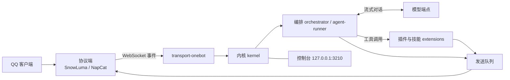

# 微光星屿 Agent（Glimmerisle Agent）

> [!IMPORTANT]
> **存档声明**（2026-11-06 首版，2026-11-17 整理目录与重写 README，均由存档者添加，非原作者内容）
> 本仓库是**第三方非官方源码存档**：非原作者、非维护者。存档代号 **微光星屿 Agent（Glimmerisle Agent）**；原项目名 **QQ Agent**（DSH 架构），原作者 Kondius——原项目名保留于此供检索。上游 GitHub 仓库已不可访问，本仓库内容为存档者本机留存的可运行快照，用于学习与研究。
> 许可证：**MIT**（版权人 Kondius），例外与第三方组件见 [LICENSE](LICENSE)。如版权人对本存档有异议，请通过 GitHub 联系存档者，将尽快处理。

---

## 一、这是什么

一句话：把一个大模型做成**「住在 QQ 里、有自己的生活节奏的人」**，而不是问一句答一句的客服。

它跑在你自己的电脑上（Electron 桌面端 + 本地控制台 `http://127.0.0.1:3210`），通过外置的 OneBot v11 协议端连 QQ。给模型配上角色卡、长期记忆和一组扩展之后，它能做到：

| 能力 | 具体表现 |
|---|---|
| **像人那样说话** | 一句话拆成几条短气泡发出，按字数留 1~3 秒打字间隔；私聊与群聊跑两套语气（群里收敛、私聊放开）；支持引用回复、@ 唤醒 |
| **记得住人** | 按成员存长期「印象」；记忆簿记事件、偏好、雷点、约定；每天夜里自动写一篇「她自己」的日记（跨天漏写会补） |
| **有自己的生活** | `her-life` 每天生成一份作息（起床、吃饭、午睡、出门），20~45 分钟醒一次主动找人说话；带睡眠时段、半夜迷糊、出门由头 |
| **会发表情和语音** | 按情绪从本地表情库挑一张；语音走 TTS，支持 `[笑]` `[叹气]` 这类声音标签，合成成真的气声而不是把字念出来 |
| **看得懂图、查得到资料** | 消息里的图片会真的去读（多模态），需要时联网搜索、翻本地资料库 |
| **可扩展** | 插件（常驻能力）与技能（一组工具）两套模型，带 manifest、权限 scope、设置面板、离线自检脚本；控制台里能看会话、调参数、装卸扩展 |
| **工程侧** | 流式输出、前缀缓存分段（省 token）、失败可诊断（`errorCode` / `send-failure` 分类明确，而不是一句「连接失败」） |

**前提**：一个 OpenAI 兼容的模型端点（官方或中转）+ 一个 QQ 协议端。会话、记忆、账本全部落在本机 `data*/` 目录，默认不上传（例外是遥测，见[第十一节](#十一已知问题与安全提示)）。

**不是什么**：不是云服务，没有服务端；不是开箱即用的 SaaS，协议端和模型 key 都要自己准备；也不是无人值守就能跑好的东西，人设、记忆、语气都要调。

## 二、它是怎么跑起来的



一句话概括：**薄内核 + 全插件**。内核只负责「收消息、拼提示词、调模型、跑工具、发消息、记账」，具体行为全部由 `extensions/` 下的插件与技能提供。

| 路径 | 职责 |
|---|---|
| `src/kernel/` | 内核（71 个模块）：配置、权限、提示词、编排、发送队列、记忆、表情、会话存档、调度器 |
| `src/console/` | 本地控制台 HTTP API（`/api/status`、`/api/config`、`/api/skills`、`/api/chats`…） |
| `src/management/` | 可视化群管理规则（节点图） |
| `src/install/` `src/update/` | 安装状态、自动更新与回滚 |
| `src/transports/` `src/protocols/` | 协议端接入与拉起 |
| `ui/` | 控制台前端（原生 JS，无框架），面板在 `ui/panels/` |
| `bundled/` | 20 个内置扩展：消息工具、记忆、表情、图片、搜索、语音转写、MCP 桥、遥测… |
| `electron/` | 桌面壳（内嵌 Chromium 打开同一个控制台） |

## 三、本仓库结构

| 目录 | 版本 | 形态 | 建议 |
|---|---|---|---|
| [`v0.5.1/`](v0.5.1) | **0.5.1** | 官方安装版的 `resources/app` 源码（源码明文，`asar: false`） | **想动手改就用这个** |
| [`v0.5.0/`](v0.5.0) | 0.5.0 | 完整可运行源码快照 + 存档者的 7 处改动 | 想对照历史差异时看 |

- **只想要能直接跑的程序** → 去 [Releases](../../releases) 下 `v0.5.1` 的开箱即用包，解压双击 `Glimmerisle Agent.exe`，不需要 `npm install`
- **0.5.1 改了什么、已知问题有哪些** → [`CHANGELOG-0.5.1.md`](CHANGELOG-0.5.1.md)
- **0.5.0 存档的改动清单与部署步骤** → [`v0.5.0/PACKAGE-README.md`](v0.5.0/PACKAGE-README.md)

## 四、安装与启动

### 4.1 用现成安装包（只想用的人走这条）

1. 去 [Releases](../../releases) 下载 `Glimmerisle-Agent-0.5.1-clean-*.zip`，解压到**空目录**
2. 双击 `Glimmerisle Agent.exe`
3. 首次启动后在控制台「设置」里填模型端点与 key，在「协议端」里填 OneBot 的 WS / HTTP 地址

> 包**不含** `data-v05/`（首次启动自动生成）和卸载器——原作者那把卸载程序的安装路径写死在它自己的目录，误点会删掉真实安装。

### 4.2 用源码跑 0.5.1

需要 **Node.js 20+**，以及一个外部 OneBot v11 协议端（SnowLuma / NapCat 等，本仓库不含）。

**双击（最省事）**

- `v0.5.1/启动本地UI.bat` —— 桌面版
- `v0.5.1/启动服务器UI.bat` —— 无头版，控制台在 `http://127.0.0.1:3210`

两个脚本都会自己检查依赖：缺 `node_modules` 就跑 `npm install`，桌面版缺 Electron 会自动装 `electron@45.3.2`。

**命令行**

```bash
cd v0.5.1
npm install
npm run server      # 无头
npm run desktop     # 桌面（需先 npm i -D electron@45.3.2）
```

> 上游安装版的 `package.json` 没有 `scripts` 段（人家靠 exe 启动），`server` / `desktop` 是存档者补的。

### 4.3 用源码跑 0.5.0

```bash
cd v0.5.0
npm install
```

然后双击 `v0.5.0/启动本地UI.bat` 或 `启动服务器UI.bat`。

### 4.4 协议端

宿主只负责「连协议端」，不内置 QQ 登录。常见组合：

- **SnowLuma / NapCat**：提供 OneBot v11 的 WS 事件 + HTTP API，推荐正向 WebSocket
- 在控制台「协议端」里填 `ws://127.0.0.1:3001/`、`http://127.0.0.1:3000/` 这类地址
- 连上后 `/api/status` 的 `onebot.stage` 变 `ready`、`errorCode` 为 `null`；连不上会直接给错误码（如 `ONEBOT_WS_UNAVAILABLE`），不会只说「连接失败」

## 五、数据存在哪

默认数据目录 `data-v05/`（源码跑 0.5.0 时是 `data/`，可用环境变量 `QQ_AGENT_DATA_DIR` 改）：

| 路径 | 内容 |
|---|---|
| `config.json` | 全部配置，**含 API key**，别外传 |
| `sessions/*.json` | 每轮对话存档（`systemPrompt` / `userPrompt` / `usage`），排查问题最有用 |
| `messages/*.json` | 消息库，一个会话一个文件 |
| `memory/<chat>/<userId>.json` | 成员印象 |
| `plugins/<id>/` | 各扩展自己的状态（`kv.json`、备份、音频…） |
| `stickers.json` + `sticker-images/` | 表情库 |
| `usage-days/*.json` | 每日 token 与花费账本 |
| `logs/<日期>.log` | 运行日志，**时间戳是 UTC** |

## 六、配置要点

配置全在 `config.json`。要改就走控制台（`POST /api/config`）——手改文件会被内存里的副本覆盖。

| 段 | 关键项 | 说明 |
|---|---|---|
| `api` | `baseUrl` `model` `visionModel` `temperature` `maxRounds` | 模型端点与参数；`visionModel` 不填就看不了图 |
| `persona` | `botName` `roleText` `participation` | 角色卡与参与度（`low` / `medium` / `high`） |
| `allow` | `groups` `private` | 白名单：**不在名单里的群和人一律不回** |
| `store` | `historyCount` `contextSliderPos` | 上下文长度与压缩档位；滑条是唯一真相，直改 `historyCount` 不等于改滑条 |
| `sticker` | `promptMaxStickers` `encourage` | 注入多少张表情、有多积极（0/1 是劝退档，2 才是正向） |
| `skills.<id>` | `enabled` `settings` | 每个扩展的开关与设置 |

## 七、写扩展

两套模型，按「要不要常驻」区分：

| | 插件 plugin | 技能 skill |
|---|---|---|
| 干什么 | 常驻能力：钩子、定时器、发送、提示词注入 | 一组工具给模型调用 |
| 典型 | 群人格、看门狗、语音条 | 资料库检索、群情报 |
| 位置 | `extensions/plugins/<id>/` | `extensions/skills/<id>/` |

最小 manifest（`plugin.json` / `skill.json`）：

```json
{
  "id": "my-plugin",
  "name": "我的插件",
  "version": "1.0.0",
  "kind": "plugin",
  "apiVersion": 1,
  "entry": "index.js",
  "enabledByDefault": false,
  "permissions": ["qq.send", "net.outbound"],
  "settings": {},
  "configSchema": {}
}
```

可申请的权限 scope（定义在 `src/kernel/permissions.js`）：

| scope | 含义 |
|---|---|
| `qq.send` | 经发送队列出站 |
| `net.outbound` | safe-fetch 出站请求 |
| `fs.namespace` | 自己的存储命名空间 |
| `fs.outsideNamespace` | 命名空间外读写 |
| `data.sessions.read` / `data.memory.read` | 读会话 / 记忆仓的脱敏视图 |
| `proc.exec` | 拉起子进程 |
| `ui.panel` | 注册控制台面板 |
| `scheduler` | 常驻定时器 |
| `mcp.connect` | 连接外部 MCP server |
| `net.raw` | 原始 socket（**不开放授权**） |

写完先跑静态自检（不执行代码）：

```bash
node scripts/extension-dev.mjs check extensions/plugins/my-plugin --json
```

> 0.5.1 的 `test` 子命令有回归：声明了权限的扩展必报「无法设置测试权限」。**`check` 可信，`test` 别当真。**

文档顺序：`docs/extension-authoring.md`（入门）→ `extension-reference.md`（参考）→ `plugin-sdk.md`（SDK）→ `v04-extension-parity.md`（0.4 迁移）。

## 八、控制台能干什么

- **会话**：看每轮实际发出的提示词、工具调用、token 与花费
- **记忆**：成员印象、记忆簿条目
- **设置**：模型、人设、白名单、表情、上下文滑条
- **扩展**：装卸、开关、改设置、看加载错误（`code` 会带原因）
- **日志**：按来源过滤
- **规则 / 群管理**：节点图配置

常用只读接口（GET 免令牌，仅限本机）：

```bash
curl http://127.0.0.1:3210/api/status     # 连接状态、用量、缓存命中、扩展错误
curl http://127.0.0.1:3210/api/skills     # 扩展清单与状态
curl http://127.0.0.1:3210/api/config     # 已脱敏的配置
curl http://127.0.0.1:3210/api/chats      # 会话列表与消息数
```

## 九、常见问题

**连不上 QQ？** 先看 `/api/status` 的 `onebot.errorCode` 与 `diagnosis`，再看 `data-v05/logs/<日期>.log`。协议端没起、端口填错、token 不匹配各有不同错误码。

**她不理我？** 三个检查点：① 对方或群在不在 `allow` 名单里（不在就不回）；② 扩展页有没有 `code=error` 的条目；③ 群里是不是既没 @ 她、也没命中唤醒词。

**语音条发不出去？** 合成走本机代理（默认 `http://127.0.0.1:7890`），可在技能设置里改或清空。代理挂掉会静默失败，日志里是「语音合成请求失败」。

**她最近不发表情了？** 先看当时跑的哪个模型——表情调用率跟模型的工具遵从性高度相关，同一套提示词换模型能从 6% 掉到 0.2%。库里还有图、工具也没被关，那就是模型问题，不是 bug。

**一次对话多少钱？** 账本在 `data-v05/usage-days/`。成本大头是**未被缓存的那部分上下文**（也就是聊天本身），缓存命中部分按 1 折计价；压提示词能降 token 数字，但省下的多是已经打折的缓存，钱省不了多少。

## 十、版本差异（0.5.1 相对 0.5.0）

内核 53 → 71 个文件（+18 个新模块）、24 个文件实质改动；内置扩展 9 个新增 + 20 个改写；控制台 +约 40 个 API。

- **产品化**：安装器（强制空目录 + 旧版迁移）、自动更新 + 回滚、托盘、多账号、从 `protocols/` 拉起协议端
- **新功能**：社区 feed、扩展市场、可视化群管理规则、MCP 桥、`ctx.registerCommand`、`ctx.storage.protect`（DPAPI）
- **架构与成本**：**启用即授权**（启用后清单内 scope 全部放行）、流式输出、记忆与表情拆「稳定前缀 + 新增后缀」以保缓存
- **治「静默失败」**：扩展加载诊断（错误码 + 中文解释）、`send-failure.js`（只带分类，不漏 token）、`/api/status` 直接返回 `errorCode`

逐条见 [`CHANGELOG-0.5.1.md`](CHANGELOG-0.5.1.md)。

## 十一、已知问题与安全提示

1. **安装包未签名**：无 Authenticode，Windows SmartScreen 会提示「未知发布者」；自动更新只信 `kondius.cn` 的 Ed25519 签名清单（单点）
2. **仍有指向原作者服务器的外联**：`kondius.cn/qq-agent/` 四处——价格表、版本检查、社区面板、技能市场。该域名目前解析不到，日志里会周期性出现 `ENOTFOUND`
3. **遥测默认开启**：`telemetry` 扩展每 6 小时上报一次，载荷 = 安装 ID + 版本 + 调用次数 + token 数 + **工具名→次数表**；不含消息正文。要关：`skills.telemetry.enabled = false`
4. **`asar: false` + 无沙箱**：任何扩展等同本机 Node 权限，`mcp-bridge` 自带 `proc.exec`。**只装你信得过的扩展**
5. **聊天正文经第三方中转**：默认走 `api.apigoto.com` 这类中转，介意就把 `api.baseUrl` 换成官方端点
6. **`extension-dev test` 在 0.5.1 有回归**（见第七节）；`/api/prompt-preview` 也不可信，验证提示词要看 `sessions/*.json` 里的 `systemPrompt`

## 十二、许可与致谢

MIT，版权人 Kondius。第三方组件有例外：`ui/panels/vendor/` 下的 GSAP 是 GSAP Standard License（专有），已从根 LICENSE 显式排除，详见 [LICENSE](LICENSE)。

本仓库只是存档：代码与设计归原作者；目录整理、0.5.1 收录、少量内核与品牌改动、扩展里的若干修复由存档者完成，逐条记在 [`CHANGELOG-0.5.1.md`](CHANGELOG-0.5.1.md) 与 [`v0.5.0/PACKAGE-README.md`](v0.5.0/PACKAGE-README.md)。
